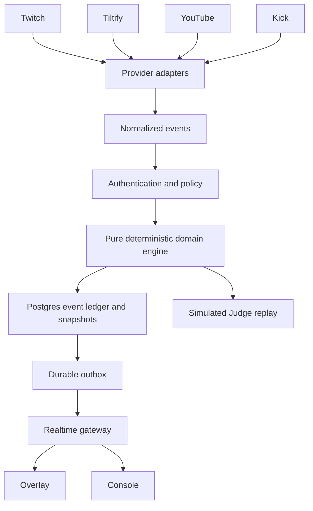

# Willie architecture

The browser may request a transition but cannot establish native evidence or authoritative custody. Judge Mode uses the same pure engine in an isolated simulated world. Domain hashing uses canonical JSON and portable SHA-256; tests compare with Node crypto. Postgres transactions serialize custody and associated proof. Vercel can host the public web surface; a persistent Node process is required for ongoing provider transports. Deployment status is recorded separately from code.
