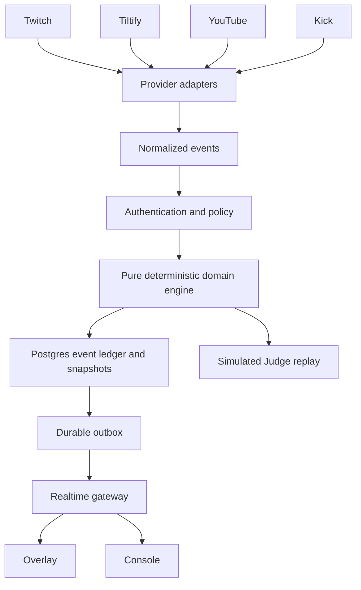
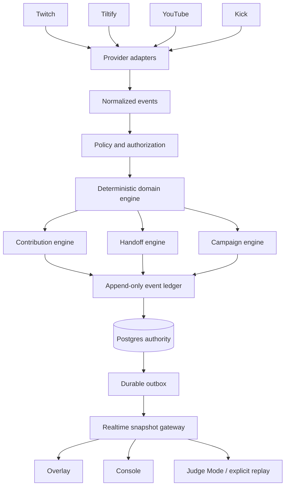

# Willie architecture

The browser may request a transition but cannot establish native evidence or authoritative custody. Judge Mode uses the same pure engine in an isolated simulated world. Domain hashing uses canonical JSON and portable SHA-256; tests compare with Node crypto. Postgres transactions serialize custody and associated proof. Vercel can host the public web surface; a persistent Node process is required for ongoing provider transports. Deployment status is recorded separately from code.

## Final provider and authority boundaries

The public Vercel deployment serves the frontend and simulated Judge. The provider server is a separate long-running container; a static deployment does not establish live provider acceptance. Migration004 adds revocation epochs, OAuth issue times and hashed identity tombstones. Every authenticated authoritative transaction rechecks its account epoch under a user-row lock. Provider polling coordination uses transaction-scoped advisory locks compatible with transaction pooling; event dedupe, generation fencing and checkpoint CAS remain authoritative after coordination lock loss.
